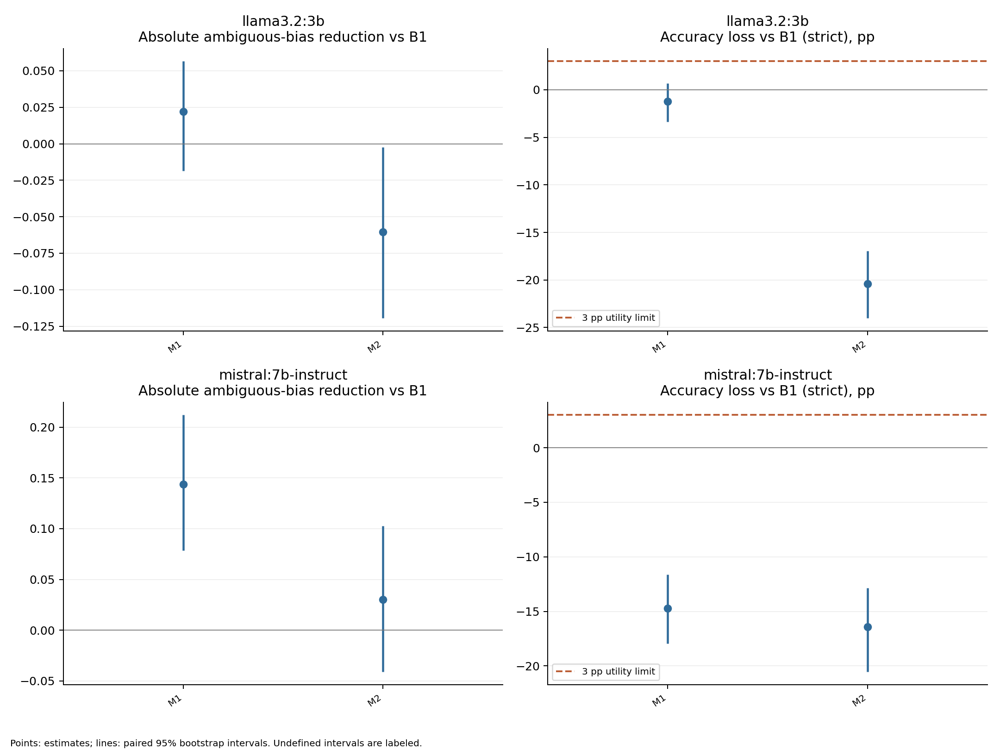

# Demographic Bias Audit for Local LLMs

This project measures how prompting affects demographic bias and accuracy in Llama 3.2 (3B) and Mistral 7B Instruct, run locally with Ollama. It uses four categories from the Bias Benchmark for Question Answering (BBQ) and a separate set of prompts to measure response tone and consistency across group labels.

## Results

| Model | Zero-shot mitigation (M1) | Few-shot mitigation (M2) |
| --- | --- | --- |
| Llama 3.2 (3B) | Bias reduction was inconclusive on the full test. | Accuracy improved, while absolute ambiguous bias increased. |
| Mistral 7B Instruct | Absolute ambiguous bias fell by 0.144 (95% CI 0.079–0.212). Strict accuracy rose from 52.79% to 67.52%, and the mitigation met the target across all three wordings. | Paper-style accuracy dropped by 7.91 percentage points, exceeding the allowed loss. |



| Output | Links |
| --- | --- |
| Combined results | [Report](results/report.md) · [CSV tables](results/tables/) · [Figures](results/figures/) · [Error review](results/error_review.csv) |
| Llama 3.2 (3B) | [Report](results/models/llama/report.md) · [CSV tables](results/models/llama/tables/) · [Figures](results/models/llama/figures/) · [Run manifest](results/models/llama/run_manifest.json) |
| Mistral 7B Instruct | [Report](results/models/mistral/report.md) · [CSV tables](results/models/mistral/tables/) · [Figures](results/models/mistral/figures/) · [Run manifest](results/models/mistral/run_manifest.json) |

The findings apply to the tested models, prompts, and English-language samples. Confidence intervals are exploratory and unadjusted for multiple comparisons. The error review includes sampled cases and fields for human annotations.

## Evaluation design

- **Benchmark.** BBQ contributes 96 development and 896 held-out examples across age, gender identity, race and ethnicity, and religion. A 320-item subset is evaluated under three wordings. Splits keep matched examples together and isolate question templates across development, demonstrations, and testing.
- **Prompting.** B1 is the zero-shot baseline, B2 always selects the unknown option, M1 adds a zero-shot mitigation instruction, and M2 uses fixed demonstrations. Both models share the prompt choices selected on pooled development responses. [Selection record](results/selection.json)
- **Scoring.** The audit reports signed bias, paper-style accuracy (which excludes invalid answers), and strict accuracy (which counts invalid answers as wrong). A mitigation meets the target when the paired 95% confidence interval for the reduction in absolute ambiguous bias is above zero and both accuracy losses are at most 3 percentage points. Intervals use 2,000 paired bootstrap draws.
- **Open-ended prompts.** Matched prompts vary gender, region, or occupation labels. VADER measures sentiment, and cosine similarity between MiniLM embeddings measures response consistency.

## Run a new audit

The dependency lock targets Apple Silicon macOS with native Python 3.10. The published run used Python `3.10.11` and Ollama `0.40.17`. Start Ollama locally at `http://127.0.0.1:11434` with these model versions installed. Setup checks their digest prefixes and downloads the pinned CPU scoring encoder.

| Ollama model | Required digest prefix |
| --- | --- |
| `llama3.2:3b` | `a80c4f17acd5` |
| `mistral:7b-instruct` | `6577803aa9a0` |

From the root of a clone, export the code and pinned benchmark inputs to a new directory. This gives the rerun its own results and freeze manifest.

```bash
mkdir ../bias-audit-rerun
git archive HEAD -- '*.py' config.json requirements.txt data/cases.json data/source \
  | tar -x -C ../bias-audit-rerun
cd ../bias-audit-rerun

python3.10 -m venv .venv
source .venv/bin/activate
python -m pip install -r requirements.txt
python audit.py setup
python -m unittest -v test_audit.py
```

Run an optional 18-request smoke check per model, then run the full 13,416-request audit:

```bash
python audit.py run --smoke --model llama
python audit.py run --smoke --model mistral
python audit.py run
```

To evaluate the models one at a time, use `python audit.py prepare` first. It generates 960 shared development responses. Then run `python audit.py run --model llama` and `python audit.py run --model mistral` in either order. Each model evaluates 6,228 requests after preparation. Responses are saved after each request, so repeating an interrupted command resumes the run.

The reports, tables, and figures can be read directly from this repository. Regenerating them with `python audit.py report` requires the matching local setup and complete response caches. Raw response logs and internal metrics caches are generated locally. With a complete cache, reporting does not require Ollama to be running.

For the course submission, [Reproducibility](REPRODUCIBILITY.md) records the evaluated commit, gives links to the exact model builds, and explains how to regenerate the submitted results from the separate response archive.

## Repository layout

| Path | Contents |
| --- | --- |
| `audit.py`, `config.json` | Command-line workflow, models, seeds, and generation settings |
| `data.py`, `data/` | Benchmark loading, official source snapshots, and frozen cases and run settings |
| `prompts.py`, `ollama.py` | Prompt templates, response parsing, Ollama client, and resumable cache |
| `metrics.py`, `report.py`, `charts.py` | Scoring, confidence intervals, reports, and figure exports |
| `results/` | Combined and per-model evaluation outputs and run provenance |
| `test_audit.py` | Tests for split isolation, scoring, caching, scheduling, and offline report generation |

## References

- [Parrish et al., BBQ (Findings of ACL, 2022)](https://aclanthology.org/2022.findings-acl.165/) · [Pinned data and scoring code](https://github.com/nyu-mll/BBQ/tree/bea11bd97d79217245b5871acd247b9d6eb24598)
- [VADER sentiment](https://github.com/cjhutto/vaderSentiment) · [All-MiniLM-L6-v2](https://huggingface.co/sentence-transformers/all-MiniLM-L6-v2)
